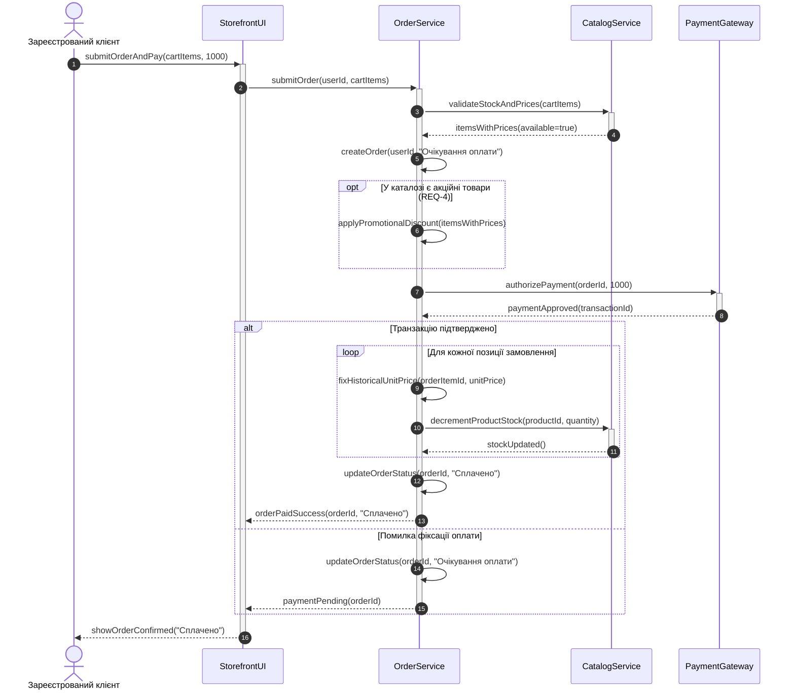
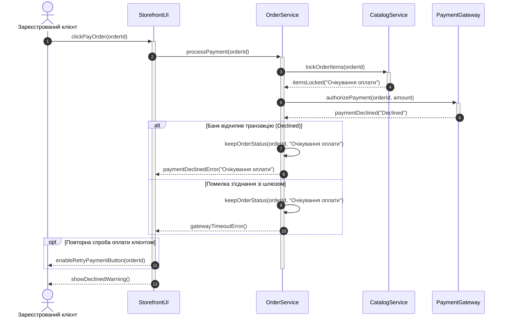
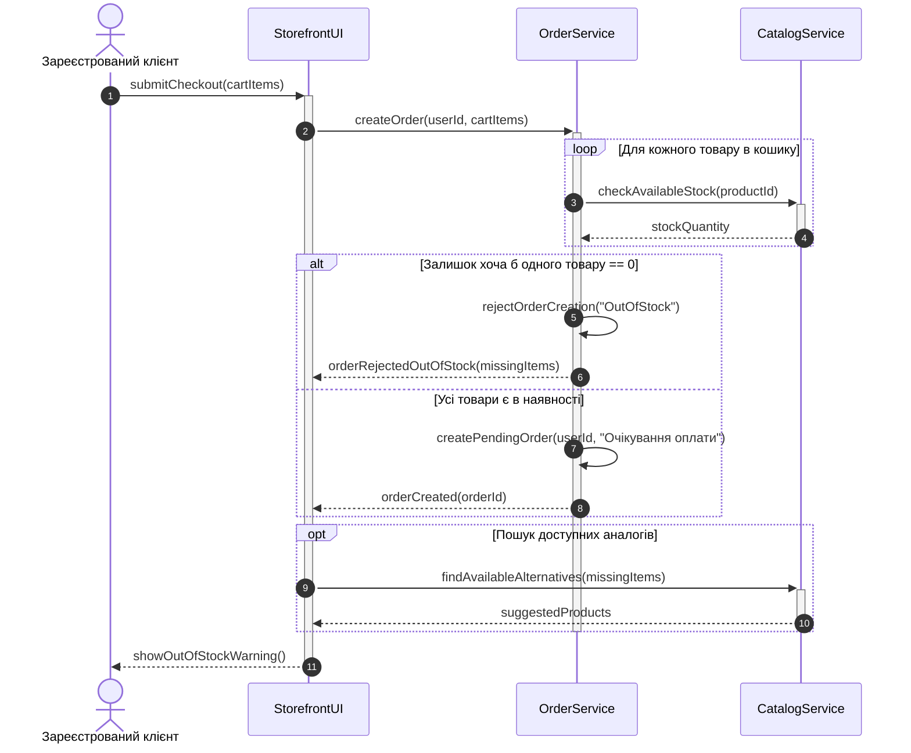
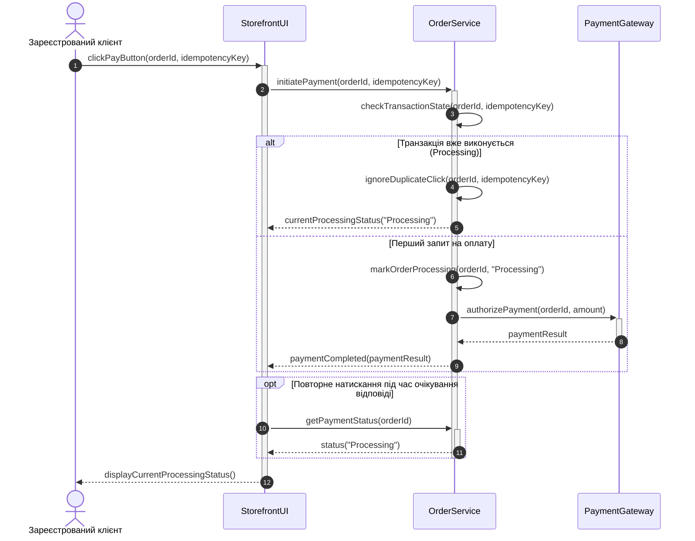

# Лабораторна робота №3: Sequence-діаграми сценаріїв

Вихідний код усіх діаграм у форматі PlantUML: [`sequences.puml`](sequences.puml).

## Сценарій 1: Успішна оплата замовлення

## Сценарій 2: Відмова шлюзу

## Сценарій 3: Товару бракує на складі

## Сценарій 4: Повторне натискання «Оплатити»
